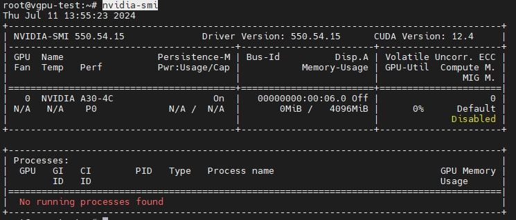

# Cấu hình vGPU card NVIDIA A30 trên OpenStack

💡 Đây chỉ là tài liệu tham khảo. Các thông số kỹ thuật hay lỗi có thể phát sinh.

## Tổng quan môi trường

| Thành phần | Thông tin |
|---|---|
| OpenStack | 2023.1 |
| Deployment | Kolla-Ansible |
| Compute OS | Ubuntu 22.04 |
| GPU | NVIDIA A30 |
| GPU `vendor_id` | `10de` |
| GPU `product_id` | `20b7` |
| GPU Driver | NVIDIA vGPU Driver 550.54.16 |

💡 Cấu hình này có thể không còn phù hợp với các môi trường mới hơn như Ubuntu 24.04 hay các loại card GPU thế hệ mới hơn.

## 1. Cài đặt gói phụ trợ, Driver
> Thực hiện trên compute GPU
Update os:

```python
apt upgrade -y
apt update -y
```

Cài đặt các gói cần thiết:

```python
apt-get install linux-source -y
apt-get install linux-headers-generic -y
update-pciids
```

Enable IOMMU trên Host `/etc/default/grub`

- Nếu chip của Host là của Intel thì đổi dòng sau:
    ```python
    GRUB_CMDLINE_LINUX="intel_iommu=on"
    ```

- Nếu chip của Host là AMD thì đổi thành:
    ```python
    GRUB_CMDLINE_LINUX="amd_iommu=on"
    ```

Rebuild lại file grub:

```bash
sudo grub-mkconfig -o /boot/grub/grub.cfg
```

Cấu hình disable nouveau

```python
cat <<EOF | sudo tee /etc/modprobe.d/blacklist-nouveau.conf
blacklist nouveau
options nouveau modeset=0
EOF
```

Khởi tạo lại kernel initramfs:

```python
sudo update-initramfs -u
```

Khởi động lại máy chủ

```python
init 6
```

Kiểm tra KVM đã lấy được SRIOV chưa. Thực hiện exec vào nova_libvirt thực hiện lệnh:

```bash
virt-host-validate
```

Kết quả PASS là thành công:

```jsx
QEMU: Checking if IOMMU is enabled by kernel                              : PASS
```

Cài đặt GCC

```python
apt install build-essential -y
```

Download Driver (Loại Ubuntu KVM) → 16.1. Sau đó thực hiện cài driver cho Host. (với các loại card khác nhau thì cần check lại các driver hỗ trợ trên trang chủ NVIDIA)

```
https://ui.licensing.nvidia.com/software
```

Truy cập thư mục chứa driver cho Host:

```python
cd /root/GPU_driver/Host_Drivers/
```

Cài đặt file driver:
```python
apt install ./nvidia-vgpu-ubuntu-535_535.104.06_amd64.deb -y
```

Reboot máy chủ:

```python
init 6
```

Kiểm tra các card GPU:
```
nvidia-smi
```
```
+-----------------------------------------------------------------------------------------+
| NVIDIA-SMI 550.54.16              Driver Version: 550.54.16      CUDA Version: N/A      |
|-----------------------------------------+------------------------+----------------------+
| GPU  Name                 Persistence-M | Bus-Id          Disp.A | Volatile Uncorr. ECC |
| Fan  Temp   Perf          Pwr:Usage/Cap |           Memory-Usage | GPU-Util  Compute M. |
|                                         |                        |               MIG M. |
|=========================================+========================+======================|
|   0  NVIDIA A30                     On  |   00000000:31:00.0 Off |                    0 |
| N/A   34C    P0             32W /  165W |       0MiB /  24576MiB |      0%      Default |
|                                         |                        |             Disabled |
+-----------------------------------------+------------------------+----------------------+
+-----------------------------------------------------------------------------------------+
| Processes:                                                                              |
|  GPU   GI   CI        PID   Type   Process name                              GPU Memory |
|        ID   ID                                                               Usage      |
|=========================================================================================|
|  No running processes found                                                             |
+-----------------------------------------------------------------------------------------+

```

## 2. Cấu hình vGPU trên Compute:

Thực hiện bật SR-IOV cho GPU chạy vGPU:    
```bash
/usr/lib/nvidia/sriov-manage -e 0000:31:00.0
```

Kiểm tra các vgpu type của card hỗ trợ:
```
ls /sys/class/mdev_bus/0000:31:00.0/mdev_supported_types
```
```
nvidia-684 nvidia-xxx nvidia-xxx nvidia-xxx ...
```

Update config nova-compute: `/etc/kolla/nova-compute/nova.conf`
```bash
# Config vGPU
[devices]
enabled_vgpu_types = nvidia-684

[mdev_nvidia-684]
device_addresses = 0000:31:00.0
```
- `nvidia-684`: type vGPU sử dụng
    
Thực hiện restart lại nova-compute service để nhận cấu hình:
    
```bash
docker restart nova_compute
```
    
Tạo script tự động enable NVIDIA SR-IOV cho GPU sau mỗi lần reboot:
    
Tạo file: `/etc/systemd/system/nvidia-sriov.service`
    
```bash
[Unit]
Description=Enable Nvidia SR-IOV

[Service]
ExecStart=/usr/lib/nvidia/sriov-manage -e 0000:31:00.0

[Install]
WantedBy=default.target
```
    

## 3. Cấu hình trên Controller:

Thêm cấu hình `filter_scheduler` vào `/etc/kolla/nova-api/nova.conf`
```bash
[filter_scheduler]

enable_isolated_aggregate_filtering = True
```
    
Thêm cấu hình `filter_scheduler` vào `/etc/kolla/nova-scheduler/nova.conf`
```bash
[filter_scheduler]

enable_isolated_aggregate_filtering = True
```
    
Restart `nova_api` và `nova_schedule`
```bash
docker restart nova_api nova_scheduler
```
    
Tạo flavor máy ảo GPU
```bash
openstack flavor create --vcpus 8 --ram 16384 --disk 0 --property "resources:VGPU=1" nvidia-684.A30.8C16R
```

Khởi tạo máy ảo từ flavor vừa tạo. Sau đó truy cập máy ảo kiểm tra sẽ thấy vgpu được gán vào máy ảo tương tự dưới đây. (Sau khi cài driver cho máy ảo, kiểm tra bằng lệnh `nvidia-smi`)


    
## Tham khảo
- https://docs.openstack.org/nova/latest/admin/virtual-gpu.html