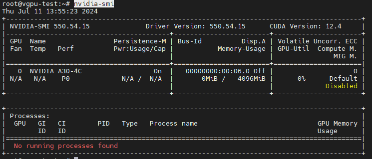
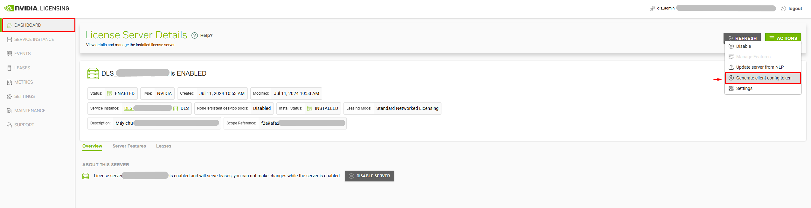
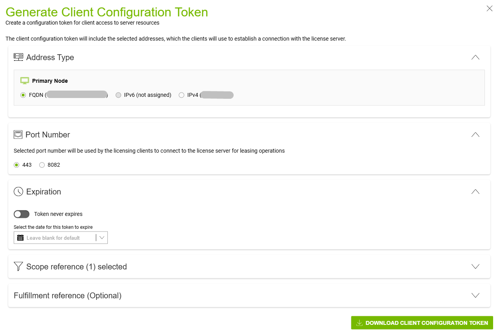
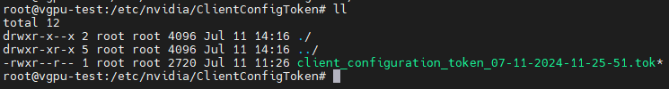
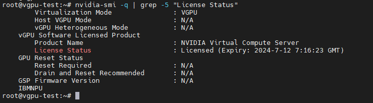

# Hướng dẫn cấu hình vGPU trên máy ảo Ubuntu

💡 Đây chỉ là tài liệu tham khảo. Các thông số kỹ thuật hay lỗi có thể phát sinh.

## Tổng quan môi trường
| Thành phần | Thông tin |
|---|---|
| OpenStack | 2023.1 |
| Deployment | Kolla-Ansible |
| Compute OS | Ubuntu 22.04 |
| GPU | NVIDIA A30 |
| GPU `vendor_id` | `10de` |
| GPU `product_id` | `20b7` |
| GPU Driver | NVIDIA vGPU Driver 550.54.16 |
| vGPU type | nvidia-684 |
| Guest (VM) OS | Ubuntu 22.04 |

💡 Cấu hình này có thể không còn phù hợp với các môi trường mới hơn như Ubuntu 24.04 hay các loại card GPU thế hệ mới hơn.

## 1. Cài đặt Driver:
> Thực hiện trên máy ảo vm-vGPU

Download file cài đặt Driver NVIDIA cho Guest về máy ảo. File driver dùng cho máy ảo sẽ trong thư mục `Guest_Driver`
```bash
cd /root/GPU_driver/Guest_Drivers/
ls -alh
total 1.1G
drwxr-xr-x 2 root root 4.0K Jan 14  2024 .
drwxr-xr-x 5 root root 4.0K Apr 13  2024 ..
-rw-r--r-- 1 root root 482M Jan 14  2024 550.54_grid_win10_win11_server2022_dch_64bit_international.exe
-rw-r--r-- 1 root root 336M Jan 14  2024 nvidia-linux-grid-550_550.54.16_amd64.deb
-rw-r--r-- 1 root root 299M Jan 14  2024 NVIDIA-Linux-x86_64-550.54.16-grid.run
```

Phân quyền:
```bash
chmod 755 nvidia-linux-grid-550_550.54.16_amd64.deb
```
    
Thực hiện cài đặt driver:
```bash
apt install ./nvidia-linux-grid-550_550.54.16_amd64.deb
```
    
Thực hiện reboot VM:
```bash
init 6
```
    
Kiểm tra vGPU đang chạy trên VM:

```bash
nvidia-smi
```



=> Máy ảo đã nhận vGPU với 4GB vRAM theo vgpu type đã cấu hình. (Đây là ảnh cũ nên driver version không khớp với bài viết)

## 2. Cấu hình license vGPU trên máy ảo
> Thực hiện trên máy ảo vm-vGPU
### Điều kiện
- Đã có license vGPU
- Đã triển khai DLS server quản lý license vGPU
- Máy ảo có kết nối tới domain endpoint DLS server

### Thực hiện cấu hình
Sửa file cấu hình `/etc/nvidia/gridd.conf` Chỉnh sửa các dòng sau:

```bash
ServerAddress=<domain_DLS>

ServerPort=443

FeatureType=4
```

Trong đó:
- ServerAddress: Địa chỉ trang quản lý license vGPU
- ServerPort: Port của máy chủ quản trị license
- FeatureType: Loại license active.
    - Nếu để 0: thì không sử dụng license
    - Ở đây mình để là `4` NVIDIA Virtual Compute Server

Download token từ DLS server (trang quản lý license vGPU):





- `Expiration`: thời hạn hết hạn token

Thực hiện copy file `ClientConfigToken` vào thư mục `/etc/nvidia/ClientConfigToken/` trên máy ảo.

Phân quyền cho file token:

```bash
chmod 744 /etc/nvidia/ClientConfigToken/client_configuration_token_<....>.tok
```



Thực hiện restart service grid:

```bash
systemctl restart nvidia-gridd.service
```

Kiểm tra service:

```bash
systemctl status nvidia-gridd.service
```

Kiểm tra việc active license:

```bash
nvidia-smi -q | grep -5 "License Status"
```

Kết quả:

```bash
...   
    vGPU Software Licensed Product
        Product Name                      : NVIDIA Virtual Compute Server
        License Status                    : Licensed (Expiry: 2024-7-12 7:16:23 GMT)
...
```



- `(Expiry: 2024-7-12 7:16:23 GMT)`: thời điểm verify license tiếp theo từ máy ảo tới DLS Server.

=> Đã cấu hình license vGPU thành công trên máy ảo